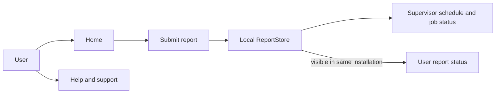

# Fix My City

Fix My City is a Flutter application for reporting municipal issues, tracking their progress, and managing the resulting work. The current active UI is for community users and supervisors; the dedicated field-worker dashboard and admin-only report/chat screens are not currently routed from the app. Field-worker and administrator role metadata and related local data remain in the model for future work, but they are not part of the current end-user flow. The current project is primarily a local prototype: it has no configured HTTP API or remote database.

## App Entry and Navigation

`lib/main.dart` initializes Flutter and `ReportStore`, then starts the app. `lib/Pages/StartUp.dart` displays the splash and welcome screens, with links to login, registration, and help.

`lib/Pages/login.dart` accepts email and password and calls `AuthStore.validateLogin`. Registration in `lib/Pages/Register.dart` collects full name, email, ward, area, and password; the area dropdown appears after a ward is selected and contains only that ward's areas. The hard-coded Ward 58, Ward 61, and Ward 62 area lists are defined in `lib/Pages/auth_store.dart`. The selected area is stored on the account; registration does not ask users to choose a username. `AuthStore` generates an internal username key from the email for compatibility with existing account and report references. Supervisor accounts are sent to the supervisor dashboard; all other accounts, including field-worker accounts, open `HomePage`. Accounts are currently held in memory, including seeded demo accounts; the seeded admin account is also a supervisor.

The diagram shows the current local-store path. Reports, assignments, schedule dates, and status updates do not synchronize between devices until a shared backend is implemented and connected.

## User Side

### Home

`lib/Pages/Home.dart` is the main user landing screen. Its drawer links to Settings, Edit Account, Contact Us, My Area, and Logout. Its bottom navigation opens community reports, new report submission, and Profile.

Home also displays area statistics and area updates. The statistics panel displays the signed-in user's selected area (for example, `Area: Fairbreeze`); the My Area selector can change the area shown there. The Ward 58, Ward 61, and Ward 62 area lists are hard-coded in `AuthStore`. Report counts and several updates remain hard-coded demo content; they are not calculated from all reports or downloaded from a service.

### Submit a Report

`lib/Pages/Reporting.dart` collects:

- Issue category and specific issue.
- Street address or landmark, with an optional pin reference. A remote-area selection makes the pin reference required.
- Additional details and an optional photo from the camera or gallery.
- Device location permission state, if the user chooses to grant it.

On submission, the page calls `ReportStore.addReport` and then opens `CheckStatus.dart`. Despite the connectivity check and success messages, the current submission path does not send a request to a server.

### Report Status

`lib/Pages/CheckStatus.dart` reads the local reports and displays their identifiers, creation/submission times, sync state, details, and status. Refreshing rebuilds the view from the local store; it does not fetch new data remotely.

### Community Reports

`lib/Pages/OtherReports.dart` reads reports from `ReportStore` and provides issue-category filtering. Reports are grouped when normalized issue type, specific issue, and area match. A group displays the earliest report ID and the number of distinct reporters. Reports from different areas remain separate. Since the current store is local, this grouping covers only reports on the same installation, not the entire community.

### Profile and Account Settings

`lib/Pages/Profile.dart` shows the current account's name, internal username, and email. It links to community reports and Contact Us and shows the signed-in user's recent reports from `ReportStore`. The verification status is no longer shown in this shared page, so it is absent for both community users and supervisors. Profile editing also no longer displays the prototype's confirmation dialogs labelled "Verify"; input validation remains. The verification field is retained in `AuthStore` for compatibility with existing account data and future backend work.

`lib/Pages/EditProfile.dart` is the profile-edit screen. `lib/Pages/Settings.dart` handles device permissions, including location and camera access, and links to Help. Device permission state is managed by the operating system and does not require a backend API.

### Areas and Area Chat

The area selector and summaries are in `Home.dart`. `AreaDetailPage` shows reports for an area and a chat-like view. `AreaReportsPage` reads matching entries from `ReportStore`, but the chat participants and messages exist only in that page's in-memory lists. They are not shared with other users or workers.

## Supervisor Side

### Supervisor Dashboard

`lib/Pages/Supervisor_dash.dart` is the supervisor landing screen. It summarizes report status and shows today's date, current time, and count of jobs scheduled for the signed-in supervisor. Selecting **Today's schedule** opens `lib/Pages/SupervisorSchedule.dart`, which lists jobs assigned for that local calendar day; selecting a job opens its detail and status flow. The separate **Report type:** selector filters today's submitted reports by Water, Electricity, or Road; its daily-count panel opens matching reports. The menu also opens Contact Us, Profile, and Settings.

### Assignment and Schedule

`ReportRequest` stores the assigned supervisor and scheduled date/time; `ReportStore.assignSupervisor` supports the local prototype's admin assignment flow. There is no admin-to-app synchronization yet. The supervisor job-allocation implementation in `lib/Pages/supervisor_jobs.dart` remains, along with worker account and assignment state; that allocation page is not currently linked from dashboard navigation.

### Job Status and Invoice

From the schedule, a supervisor advances jobs through:

`Assigned -> In progress -> On-site -> Completed`

The group status is updated for its member reports so users' status views can display the current status from the same local store. `lib/Pages/CheckStatus.dart` reads report status from `ReportStore`. Status updates are not currently sent to users on other devices.

The supervisor schedule opens the invoice/job-logbook form in `lib/Pages/JobCompletion.dart`. It collects worker name and ID, job number, address or pin, start/stop/total time, and manager/worker signatures. Saving marks the group **Completed** and its invoice **Pending admin submission**. It does not send the invoice to the admin until the backend is implemented.

### Removed Field-Worker and Administrator UI

The field-worker assigned-jobs screen (`Suprevisor_view_reports.dart`) and standalone admin reports page (`AdminViewReports.dart`) have been removed. The former exposed worker job-status updates and a worker logbook route; the latter showed only local sample reports and was not connected to the shared report store or a backend. Field-worker accounts still retain their role and report assignment data, but signing in now opens the community `HomePage`; there is no in-app field-worker job-status or logbook-entry screen. Supervisor scheduling and its logbook remain available. These are UI removals only: report/account state and the planned admin API contract are unchanged.

## Support and Contact Links

`lib/Pages/Help.dart` is linked from the startup screen and user and supervisor pages. It provides:

- **Call support:** launches the phone app using `url_launcher` and a configured phone number. This device action does not require a backend, though the number should be confirmed for deployment.

The in-memory "Chat with an admin" mock has been removed because its messages were never delivered to an administrator. The current help screen only offers phone support, and there is no dedicated admin report or admin chat screen in the active app. Admin role state and the retained supervisor-allocation permissions remain in the local model for future backend work.

`lib/Pages/ContactUs.dart` displays static email, phone, office hours, and support text. These values are presentation content and should be replaced with verified contact information. They only need an API if the organization wants to manage them remotely.

## Shared Data and Current Persistence

`lib/Pages/auth_store.dart` defines the account model and in-memory operations for login, registration, field-worker creation, profile updates, roles, and verification metadata. The data is not backed by a server and is not persisted across app restarts. Passwords are represented directly in local account objects, which is suitable only for a prototype. Verification metadata remains in state, but this app currently has no verification UI or verification service.

`lib/Pages/report_store.dart` defines `ReportRequest`, `ReportGroup`, and the shared `ReportStore`. It serializes reports to JSON and stores them in `shared_preferences`. The report model includes issue, area, description, status, assigned supervisor/schedule, image path, sync metadata, and worker completion/invoice fields. Grouping uses issue type, specific issue, and area; the count is distinct reporters and the earliest report ID is used as the group's display ID.

`lib/Pages/api_paths.dart` and [`API_CONTRACT.md`](API_CONTRACT.md) define the planned shared API routes for admin assignment, supervisor report listing and daily schedule, status updates, and invoice submission. These are contracts and client path helpers only; no HTTP client or backend service is currently configured. The app remains a local prototype, so schedules, user-visible status changes, and completed invoices are not shared across devices or delivered to the admin website yet.

Connectivity is checked with `connectivity_plus`, but network availability is not the same as a successful server connection. The current `addReport` implementation creates reports as offline/queued locally. `syncPendingReports` accepts a callback for sending queued records, but no app code currently supplies or invokes that callback. The form passes an image path, but the current store creation path does not retain it in the new report. These are implementation gaps to resolve during API integration.

## What Needs an API

The project dependencies in `pubspec.yaml` do not include an HTTP client, Firebase SDK, or another backend client. A backend integration should make the server the source of truth for accounts, reports, assignments, status, invoices, and shared conversations. See [`API_CONTRACT.md`](API_CONTRACT.md) for the current assignment, schedule, status, and invoice route contract.

### 1. Authentication and Accounts

Add server operations for:

- Register account and reject duplicate emails.
- Authenticate by email and password, and issue/refresh/revoke a secure session token.
- Fetch and update the signed-in profile.
- Verify an email address.
- Request a password reset and complete it using a one-time reset token.
- List/create worker accounts only for authorized administrators.

Enforce user, worker, and administrator permissions on the server. Do not send or store raw passwords outside the authentication flow. Replace local demo credentials and `AuthStore` authentication with responses from this service.

### 2. Reports and Work Orders

Add operations to:

- Create a report and return its server ID and initial status.
- List the signed-in user's reports and fetch one report's details/status.
- List community reports with area/category filters.
- Let admins assign grouped reports to supervisors with a scheduled date and time.
- List a supervisor's assigned groups by day; let the assigned supervisor update job status.
- Submit completed job invoices to the admin and retrieve the resulting logbook data, signatures, and invoice/job identifiers.
- Group matching reports across all users by normalized issue type, specific issue, and area, preserving separate groups for different areas and returning first report ID and distinct reporter count.
- Return area summaries and counts from actual report records.

Use server-side authorization so users see their own data and workers see only permitted work. Use stable server IDs rather than local incrementing IDs.

### 3. Images and Offline Sync

Upload report images as multipart data or through a signed upload URL, then save the returned file reference with the report. For offline reports, retry queued submissions when connectivity returns. Include an idempotency key per local report so retrying after a timeout cannot create duplicates. Update the UI's sync state from the server response, not merely the device connectivity state.

### 4. Area Chat and Support Chat

Persist area membership and messages in a service that can authorize who may join each area. For support, create a private conversation, send and retrieve messages, and provide a way for an admin to reply. A real-time transport or polling is needed for messages to appear promptly on both sides. The current in-memory message lists can remain as UI state, but should be populated by and submitted to the service.

## Suggested Integration Order

1. Implement authentication by email and role-based authorization.
2. Implement report creation, cross-user report grouping, and user report history.
3. Implement admin supervisor assignments and daily schedules.
4. Implement shared status updates and invoice submission for admin review.
5. Add photo upload and reliable offline synchronization.
6. Replace hard-coded area statistics with backend queries.
7. Add persisted area chat and private support chat.
8. Add server-driven notifications for report status changes and support replies.

## Key Source Files

- App entry: `lib/main.dart`
- Startup and routing: `lib/Pages/StartUp.dart`, `lib/Pages/login.dart`
- Account state: `lib/Pages/auth_store.dart`
- User screens: `lib/Pages/Home.dart`, `lib/Pages/Reporting.dart`, `lib/Pages/CheckStatus.dart`, `lib/Pages/Profile.dart`
- Community reports: `lib/Pages/OtherReports.dart`
- Supervisor screens: `lib/Pages/Supervisor_dash.dart`, `lib/Pages/SupervisorSchedule.dart`, `lib/Pages/supervisor_jobs.dart`, `lib/Pages/JobCompletion.dart`
- Report model and local persistence: `lib/Pages/report_store.dart`
- API route contract and path helpers: `API_CONTRACT.md`, `lib/Pages/api_paths.dart`
- Help and contact: `lib/Pages/Help.dart`, `lib/Pages/ContactUs.dart`
